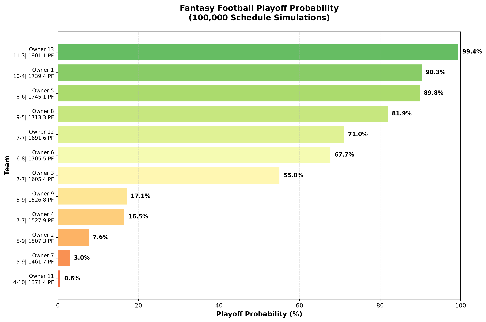
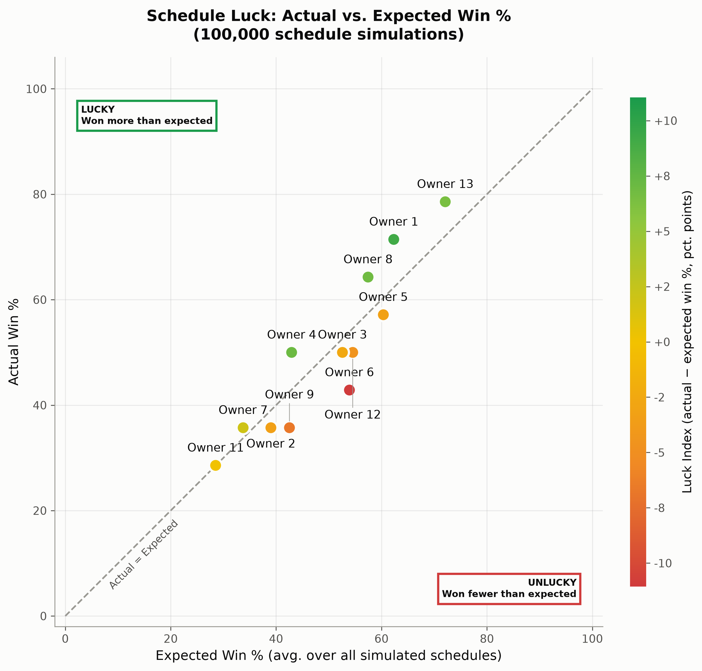
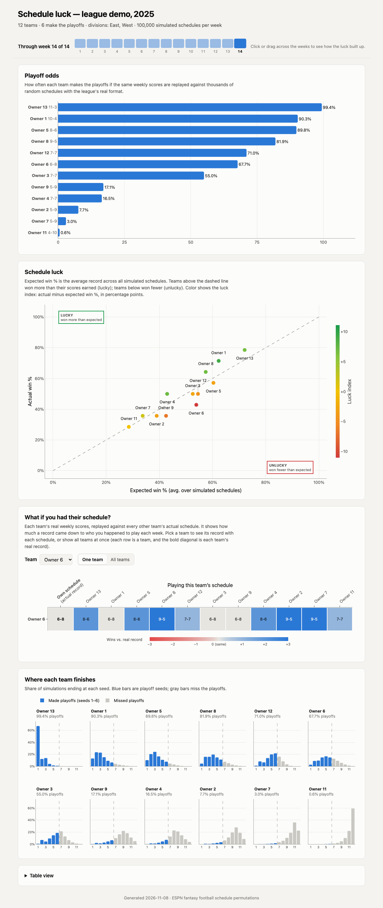

# ESPN Fantasy Football playoff probability analysis

In my 2025 fantasy football season, I scored the 2nd-most points in my 12-team league and still missed the playoffs. That raised a question: how unlucky was I, really? This project answers it for any ESPN league.

Here's an example from an anonymized 12-team league, where 6 teams make the playoffs. **Owner 6** scored the 5th-most points but went 6-8 and missed the playoffs. Replaying the same weekly scores against 100,000 random schedules, Owner 6 makes the playoffs 68% of the time. Owner 3 *did* make it at 7-7, despite scoring about 100 fewer points.



## Understanding schedule luck
Fantasy football has inherent randomness. Your record doesn't just depend on how well your team performs - it also depends on when you face each opponent. You could have a great week but lose to the one person who had an even better week. Conversely, you could squeak by with a mediocre score because you happened to face the lowest-scoring team that week.

## The simulation approach

To quantify how lucky or unlucky each team's season was, the project runs a Monte Carlo simulation that:

1. Preserves actual performance: Uses the real weekly scores each team achieved throughout the season
2. Randomizes matchups: Generates thousands of alternative schedules by randomly reassigning teams to the slots of the league's real schedule, so every simulated season keeps the league's actual format (division games, repeat matchups, byes)
3. Simulates outcomes: For each random schedule, applies the league's playoff rules to determine which teams would have made the playoffs
4. Calculates probabilities: Tracks how often each team makes the playoffs across all simulations
5. Measures expected wins: Tracks each team's average win percentage across all simulated schedules, i.e. the record a team "should" have had with a schedule-neutral draw

## League formats

The league's format and rules are read from ESPN, so the simulation adapts to:

- **Any league size, odd or even:** in odd leagues one team has a bye each week. Byes don't count as games, so they don't affect win percentage.
- **Divisions:** teams are reassigned to schedule slots completely at random, so a team can land in either division. Being placed in a tough or weak division is treated as part of the luck being measured.
- **Playoff rules:** the number of playoff teams comes from the league settings. Each division winner gets a spot, then the remaining spots go to the best records in the league. Teams are ranked by win percentage, with ties broken by the league's tiebreaker (total points scored, or head-to-head record). This matches the playoff seeds ESPN assigns.
- **Ties:** equal weekly scores count as a tie (half a win) for both teams.
- **Seasons in progress:** only completed weeks are simulated, and playoff weeks are never counted as regular-season games.

If the schedule and settings files are missing (for example, data fetched with an older version of this tool), the simulation falls back to random round-robin schedules with no divisions and 6 playoff teams.

Not yet modeled: playoff tiebreakers other than total points and head-to-head, and matchup tie rules other than allowing ties. If a league uses one, the simulation falls back to total points and allowing ties, and the report shows a note saying so.

## Measuring luck

Playoff odds show *what* the schedule cost a team, but not *how much* luck was involved. To measure that directly, the simulation also produces a luck scatterplot:



- **Expected Win % (x-axis):** a team's average win percentage across all simulated schedules (ties count as half a win)
- **Actual Win % (y-axis):** the team's real record (ties count as half a win)
- **Luck Index (color):** actual minus expected win %, in percentage points, from red (unlucky) through yellow (neutral) to green (lucky)

Teams on the dashed diagonal got exactly the record their scores earned. Teams above it (top-left, **lucky**) won more games than their scores deserved; teams below it (bottom-right, **unlucky**) won fewer.

In the example league, Owner 6's scores were good enough to win about 54% of the time across all simulated schedules, yet they finished 6-8 (43%). That's a luck index of −11, the unluckiest team in the league. At the other end, Owner 1 went 10-4 (71%) with scores that earned about 62%, a luck index of +9.


# Two ways to use it

| | **Chrome extension** (easiest) | **Python tool** |
|---|---|---|
| Install | Add the extension to Chrome (about a minute) | Install uv, download the project, set up a `.env` file |
| Run | Open your league on ESPN, click **Build report** | `uv run python run_all.py` |
| You get | The report in your browser, plus a **PDF** to share with your league | The same report as a web page, plus PNG plots and CSV files |

## Chrome extension
1. Download this project: click the green **Code** button on the [GitHub page](https://github.com/fajardgb/espn-fantasy-football-schedule-permutations) → **Download ZIP**, and unzip it.
2. In Chrome, go to `chrome://extensions`, turn on **Developer mode** (top right), click **Load unpacked**, and choose the `chrome_extension` folder inside the project.
3. Log in to ESPN, open your league on [fantasy.espn.com](https://fantasy.espn.com/football/), click the extension's icon (pin it from the puzzle-piece menu), and click **Build report**.

Everything runs in your browser, and your ESPN login never leaves it. See the [extension's README](./chrome_extension/README.md) for details.

The rest of this page covers the Python tool.

# Installation (Python tool)
## Before you start
You'll need:
- **uv**, a tool that installs Python and everything this project needs in one step. Install it by following the one-line instructions at [docs.astral.sh/uv](https://docs.astral.sh/uv/getting-started/installation/). uv downloads the right Python version (3.14) automatically, so you don't need to install Python yourself.
- A **terminal**: Terminal on a Mac, or PowerShell on Windows. Every command below is typed there.

*Already have Python?* You can use pip instead of uv, but you'll need **Python 3.14 or newer** (check with `python --version`).

## Setup (one time)

**1. Download the project**

If you have git:
```
git clone https://github.com/fajardgb/espn-fantasy-football-schedule-permutations.git
cd espn-fantasy-football-schedule-permutations
```
No git? On the [GitHub page](https://github.com/fajardgb/espn-fantasy-football-schedule-permutations), click the green **Code** button → **Download ZIP**, unzip it, then in your terminal `cd` into the unzipped folder.

**2. Install dependencies**

With uv (recommended):
```
uv sync
```
Or with pip:
```
pip install -r requirements.txt
```

**3. Configure your league**

Make a copy of the example settings file named `.env`:
```
cp .env_example .env
```
(On Windows PowerShell: `Copy-Item .env_example .env`.) Files starting with a dot can be hidden. On a Mac, press `Cmd + Shift + .` in Finder to show them.

> **Shortcut: use the Chrome extension.** The [Chrome extension](./chrome_extension/) finds all four values for you. Open your league on ESPN, click the extension, click **Copy as .env**, and paste the result into `.env`. Installing it takes about a minute (see [its instructions](./chrome_extension/README.md)). If you use it, you can skip Steps 1 and 2 below.

To fill it in by hand, open `.env` in any text editor and fill in the four values below. When you're done it should look like this (with your own values):
```
LEAGUE_ID=12345678
YEAR=2025
ESPN_S2=AEBx7k...a long string of letters, numbers and % signs...
SWID={1A2B3C4D-5E6F-7A8B-9C0D-1E2F3A4B5C6D}
```

### Step 1: League ID and year
1. Open your league on [fantasy.espn.com](https://fantasy.espn.com) in a web browser (not the app).
2. Look at the address bar. It will look something like:
   `https://fantasy.espn.com/football/league?leagueId=12345678&seasonId=2025`
3. The number after `leagueId=` is your **LEAGUE_ID** (`12345678` here).
   *Shortcut:* you can paste the whole address as `LEAGUE_ID` instead, and the scripts will pick out the league ID (and the year, if `seasonId=` is in it).
4. **YEAR** is the season you want to analyze: the year the season *started*. For example, the season that ran September 2025 – January 2026 is `2025`. It's the number after `seasonId=` when you're viewing that season.

### Step 2: ESPN_S2 and SWID (private leagues only)
These two values are "cookies": small pieces of text your browser stores to remember you're logged in to ESPN. The scripts need them to read a private league's data, just as your browser does.

> **Is your league public?** If your commissioner has made the league viewable to the public (a setting in the league's basic settings), skip this step. Leave `ESPN_S2=` and `SWID=` empty in `.env`.

1. In the same browser, make sure you're **logged in** to ESPN and on your league page.
2. Open the browser's developer tools:

   | Browser | How to open | Where the cookies are |
   |---|---|---|
   | **Chrome / Edge** | `F12`, or `Cmd + Option + I` on a Mac | **Application** tab → **Storage** → **Cookies** → `https://fantasy.espn.com` |
   | **Firefox** | `F12`, or `Cmd + Option + I` on a Mac | **Storage** tab → **Cookies** → `https://fantasy.espn.com` |
   | **Safari** | First turn on Safari → Settings → Advanced → "Show features for web developers". Then `Cmd + Option + I` | **Storage** tab → **Cookies** → `fantasy.espn.com` |

   If you don't see the tab, click `>>` at the top of the developer tools panel to find it.
3. You'll see a table of cookies. Type `espn_s2` into the **Filter** box above it, then double-click the **Value** cell and copy the whole thing. That's your **ESPN_S2**. It's long (a few hundred characters), so make sure you copy all of it.
4. Clear the filter, type `SWID`, and copy its value the same way. That's your **SWID**. It looks like `{1A2B3C4D-...}`. Copy it exactly as shown, including the curly braces if there are any.
5. Paste each value into `.env` right after the `=` sign, with no spaces or quotes.

> **Keep these private.** Your `ESPN_S2` and `SWID` act like a password: anyone who has them can use your ESPN account. Don't share your `.env` file or post the values anywhere, including when asking for help (`ESPN_S2=...` is enough). If they've been shared by accident, log out of ESPN and back in to get new ones. (`.env` is already excluded from git.)

### Troubleshooting
The scripts explain what went wrong in plain language. The most common problems:
- **`401 Unauthorized` error:** the league is private and the cookies are missing, mistyped, or expired. Check that you copied all of `ESPN_S2`, and `SWID` exactly as shown. Logging out of ESPN expires the cookies, so if you've logged out since copying them, log back in and copy them again.
- **`404 Not Found` or `error 400`:** the `LEAGUE_ID` or `YEAR` is wrong, or the league didn't exist that season.
- **"No data found for league..."** when running the simulation or report on its own: download the data first (`get_espn_league_data.py`), or just use `run_all.py`.

# Usage
If you installed with pip, drop the `uv run` prefix from the commands below.

## Run everything (recommended)
```
uv run python run_all.py
```
This downloads your league from ESPN, runs the simulations, saves the plots, and builds the shareable report. When it's done, the report opens in your browser. Options:
- `--sims 20000`: number of simulated schedules (default 100000; fewer is faster, more is more precise)
- `--offline`: embed the charting library in the report so it works without internet (adds ~5 MB)
- `--skip-download`: reuse the data downloaded last time instead of fetching it again
- `--no-open`: don't open the report automatically
- `--seed 7`: change the random seed (default 42)

## The shareable report
The report is a single `.html` file with interactive charts and a **"through week N"** slider that shows how the luck built up over the season. Open it in any browser, send it to your league, or host it as a static web page. Add `#week=5` to the end of its address to open it at a given week.

It contains:
- **Playoff odds** for each team
- **Schedule luck**: actual vs. expected win %, colored by luck index
- **What if you had their schedule?**: a heatmap of every team's record if it had played every other team's real schedule
- **Where each team finishes**: the distribution of final seeds for each team, one small chart per team
- A table view of the numbers

Here's the full report for the example league (built from an anonymized real league):



To try the interactive version (slider, hover details), download [the example report file](./output_example/leaguedemo_year2025/leaguedemo_year2025_report.html) and open it in your browser.

## Running the steps separately
`run_all.py` runs these three scripts in order. You can also run them one at a time:
```
uv run python get_espn_league_data.py           # 1. download scores, schedule, and league settings
uv run python simulate_schedule_permutations.py # 2. simulate and save the PNG plots
uv run python build_report.py                   # 3. build the HTML report (takes --sims, --seed, --offline)
```

## Running the tests
```
uv sync
uv run pytest
```
With pip, install pytest first (`pip install pytest`), then run `pytest`.
The tests cover league sizes from 4 to 16 teams (odd and even), different season lengths, divisions, ties, head-to-head tiebreakers, setup errors, and parsing ESPN API responses. API tests use anonymized copies of real ESPN responses in `tests/fixtures/`, so no credentials or network access are needed.

The Chrome extension has its own tests, which need [Node.js](https://nodejs.org/) 20 or newer:
```
cd chrome_extension && npm test
```
The extension runs a JavaScript copy of the simulation, which is tested against reference results from the Python code. If you change the Python logic, regenerate them with `uv run python chrome_extension/tests/make_golden.py` (a Python test fails until you do).

## Outputs
Everything is written to `output/league<LEAGUE_ID>_year<YEAR>/`:

| File | Description |
|------|-------------|
| `league<ID>_year<YEAR>_report.html` | Shareable interactive report |
| `league<ID>_year<YEAR>_playoff_probabilities.png` | Bar chart of each team's playoff probability |
| `league<ID>_year<YEAR>_luck_scatterplot.png` | Actual vs. expected win % scatterplot, colored by luck index |
| `data/fantasy_scores_wide_league<ID>_y<YEAR>.csv` | Each team's ESPN team ID, division, record, and weekly scores (completed regular-season weeks only) |
| `data/schedule_league<ID>_y<YEAR>.csv` | The league's full regular-season schedule, including weeks not yet played |
| `data/league_settings_league<ID>_y<YEAR>.json` | League rules used by the simulation: playoff team count, playoff tiebreaker, season length, tie rule, and divisions |
| `data/playoff_probabilities_league<ID>_y<YEAR>.csv` | Per-team simulation results |

The results CSV contains these columns:

| Column | Description |
|--------|-------------|
| `Team` | The team, shown by its owner's name |
| `Actual Record` | Real W-L (or W-L-T) record |
| `Points For` | Total points scored |
| `Actual Win %` | Win percentage from the real record |
| `Expected Win %` | Average win percentage across all simulated schedules (ties count as half a win) |
| `Luck (pp)` | Actual minus expected win %, in percentage points |
| `Playoff %` | Share of simulated schedules in which the team made the playoffs |

Example outputs:
- [`output_example/leaguedemo_year2025/`](./output_example/leaguedemo_year2025/): a complete set of outputs (report, plots, and data files) built from an anonymized real league.
- [`output_example/league12345_year2025/`](./output_example/league12345_year2025/): the plots from my own 2025 season. They were made before schedule and settings files existed, so they use random round-robin schedules without divisions.
