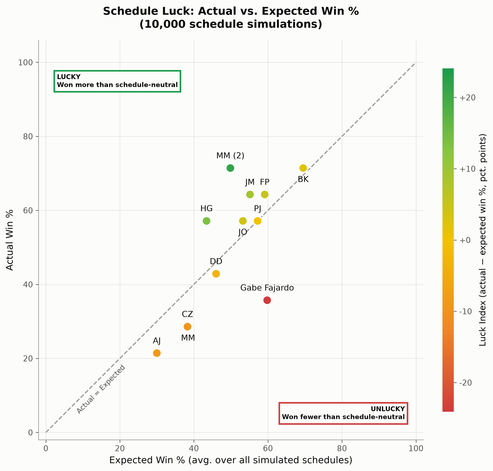

# ESPN Fantasy Football playoff probability analysis

In my 2025 fantasy football season, I experienced a frustrating outcome: despite scoring the 2nd highest points in a 12-team league, I failed to make the playoffs (top-6 team advance). This result (shown below) prompted me to ask: How unlucky was I, really? 


## Understanding schedule luck
Fantasy football has inherent randomness. Your record doesn't just depend on how well your team performs - it also depends on when you face each opponent. You could have a great week but lose to the one person who had an even better week. Conversely, you could squeak by with a mediocre score because you happened to face the lowest-scoring team that week.

## The simulation approach

To quantify exactly how unlucky my season was, I created a Monte Carlo simulation that:

1. Preserves actual performance: Uses the real weekly scores each team achieved throughout the season
2. Randomizes matchups: Generates thousands of alternative valid schedules using a round-robin algorithm
3. Simulates outcomes: For each random schedule, determines which teams would have made the playoffs
4. Calculates probabilities: Tracks how often each team makes the playoffs across all simulations
5. Measures expected wins: Tracks each team's average win percentage across all simulated schedules, i.e. the record a team "should" have had with a schedule-neutral draw

## Measuring luck

Playoff odds show *what* the schedule cost me, but not *how much* luck was involved. To measure that directly, the simulation also produces a luck scatterplot:



- **Expected Win % (x-axis):** a team's average win percentage across all simulated schedules
- **Actual Win % (y-axis):** the team's real record (ties count as half a win)
- **Luck Index (color):** actual minus expected win %, in percentage points, from red (unlucky) through yellow (neutral) to green (lucky)

Teams on the dashed diagonal got exactly the record their scores earned. Teams above it (top-left, **lucky**) won more games than their scores deserved; teams below it (bottom-right, **unlucky**) won fewer.

In my case, my scores were good enough to win about 60% of the time across all possible schedules, yet I finished 5-9 (36%). That's a luck index of −24, the unluckiest team in the league.


# Installation
## Quick setup

1. Clone the repository
```
git clone https://github.com/fajardgb/espn-fantasy-football-schedule-permutations.git
cd espn-fantasy-football-schedule-permutations
```

2. Install dependencies

With [uv](https://docs.astral.sh/uv/) (recommended):
```
uv sync
```
Or with pip:
```
pip install -r requirements.txt
```

3. Configure credentials
```
cp .env_example .env
# Edit .env with your league ID, year, ESPN S2 and SWID
```
To find these credentials:
- Log into ESPN Fantasy Football in your browser
    - Your league ID will be in the URL
    - The year is the fantasy season of interest
- Open Developer Tools (F12)
- Go to Application/Storage > Cookies
- Find 'espn_s2' and 'SWID' values
# Usage
If you installed with pip, drop the `uv run` prefix from the commands below.

1. Fetch league data
```
uv run python get_espn_league_data.py
```
2. Simulate schedule permutations and generate plots
```
uv run python simulate_schedule_permutations.py
```

## Outputs
Everything is written to `output/league<LEAGUE_ID>_year<YEAR>/`:

| File | Description |
|------|-------------|
| `league<ID>_year<YEAR>_playoff_probabilities.png` | Bar chart of each team's playoff probability |
| `league<ID>_year<YEAR>_luck_scatterplot.png` | Actual vs. expected win % scatterplot, colored by luck index |
| `data/fantasy_scores_wide_league<ID>_y<YEAR>.csv` | Weekly scores fetched from ESPN (input to the simulation) |
| `data/playoff_probabilities_league<ID>_y<YEAR>.csv` | Per-team simulation results |

The results CSV contains these columns:

| Column | Description |
|--------|-------------|
| `Player` | Team owner name |
| `Actual Record` | Real W-L record |
| `Points For` | Total points scored |
| `Actual Win %` | Win percentage from the real record |
| `Expected Win %` | Average win percentage across all simulated schedules |
| `Luck (pp)` | Actual minus expected win %, in percentage points |
| `Playoff %` | Share of simulated schedules in which the team made the playoffs |

See [`output_example/`](./output_example/league12345_year2025/) for a full set of example outputs.

