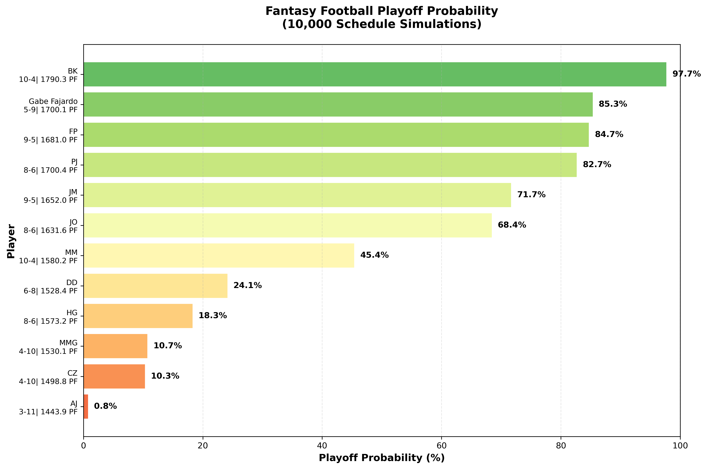

# ESPN Fantasy Football playoff probability analysis

In my 2025 fantasy football season, I experienced a frustrating outcome: despite scoring the 2nd highest points in a 12-team league, I failed to make the playoffs (top-6 team advance). This result (shown below) prompted me to ask: How unlucky was I, really? 



## Understanding schedule luck
Fantasy football has inherent randomness. Your record doesn't just depend on how well your team performs - it also depends on when you face each opponent. You could have a great week but lose to the one person who had an even better week. Conversely, you could squeak by with a mediocre score because you happened to face the lowest-scoring team that week.

## The simulation approach

To quantify exactly how unlucky my season was, I created a Monte Carlo simulation that:

1. Preserves actual performance: Uses the real weekly scores each team achieved throughout the season
2.Randomizes matchups: Generates thousands of alternative valid schedules using a round-robin algorithm
3. Simulates outcomes: For each random schedule, determines which teams would have made the playoffs
4. Calculates probabilities: Tracks how often each team makes the playoffs across all simulations

# Installation
## Quick setup

1. Clone the repository
```
git clone https://github.com/yourusername/espn-fantasy-football-schedule-permutations.git
cd espn-fantasy-football-schedule-permutations
```

2. Configure credentials
```
cp .env_example .env
# Edit .env with your league ID, year, ESPN S2 and SWID
```
To find these credentials:
- Log into ESPN Fantasy Football in your browser
    - Your league ID will be in the URL
    - The year is the fantasy season of interest
- Open Developer Tools (F12)
- Go to Application/Storage > Cookies
- Find 'espn_s2' and 'SWID' values
# Usage
1. Fetch league data
```
python get_espn_league_data.py
```
2. Plot playoff percentage across permutations
```
python simulate_schedule_permutations.py
```

